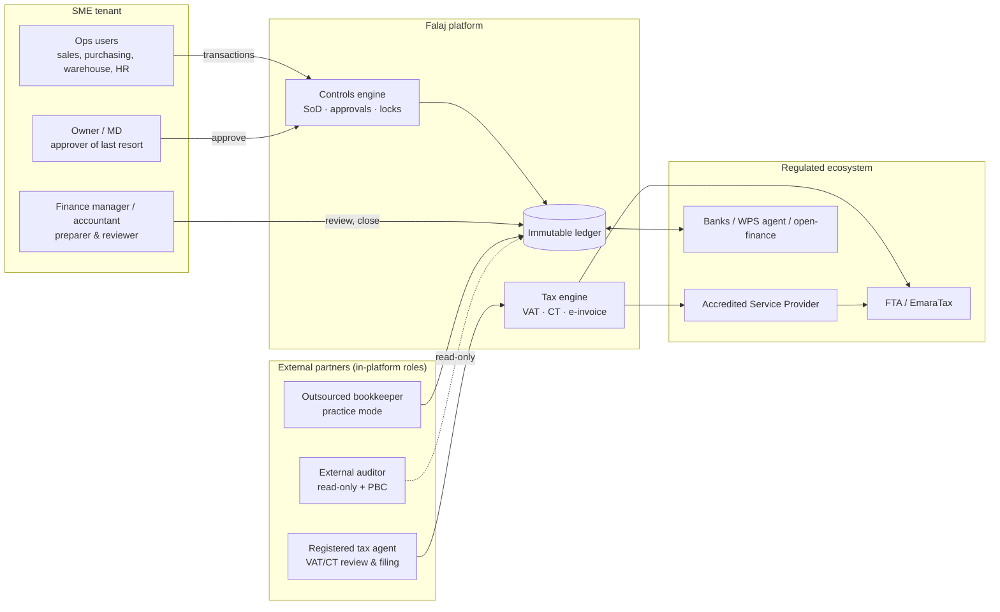

# 02 — Big Four-style SME diagnostic

> **Updated 1 Oct 2026:** positioning, phasing, verticals and channel are superseded by the **Falaj Company OS Strategy v2**. See [`10-strategy-alignment.md`](10-strategy-alignment.md). The compliance and ledger content below still stands.

> Not legal or tax advice. This is a *typical-client* diagnostic synthesised for product design, not an engagement report on a specific entity.

## 2.0 Scope and approach

| Item | Approach |
|---|---|
| Frameworks | **COSO Internal Control – Integrated Framework (2013)**: 5 components, 17 principles. **ISA** audit-evidence expectations (ISA 230 documentation, ISA 315 risk assessment, ISA 330 responses, ISA 500 evidence, ISA 550 related parties, ISA 501 inventory attendance). **IFRS / IFRS for SMEs**. **APQC PCF** (cross-industry) for the process taxonomy. **POLISM** operating-model canvas. |
| Reference client | UAE mainland LLC or free-zone FZ-LLC; AED 5–60m revenue; 20–120 staff; owner-managed; 1–3 finance staff plus an outsourced bookkeeper or tax agent; external statutory auditor (required by the free zone, or for bank facilities). |
| Evidence base | Common findings from UAE SME audit management letters, FTA audit themes, bank credit reviews and ERP implementation discoveries. These are **patterns**, to be validated in customer-discovery interviews (target n = 30 before Phase 1 GA). |

---

## 2.1 Current-state pain points

| ID | Pain point | Process | Consequence |
|---|---|---|---|
| P-01 | Owner or a single accountant raises, approves and pays vendor invoices | P2P | Fraud risk; audit qualification on the control environment |
| P-02 | Bank recs done monthly or quarterly in Excel; PDCs tracked in a notebook or spreadsheet | Treasury | Cash position unknown; bounced cheques discovered late |
| P-03 | VAT201 compiled manually from sales/purchase exports; RCM on imports missed | R2R / Tax | FTA penalties; voluntary disclosures |
| P-04 | Tax-invoice mandatory fields are incomplete (TRN, Arabic/English, "Tax Invoice" label, VAT per line) | O2C | Input VAT disallowed for customers; FTA penalties |
| P-05 | No CT working papers; non-deductibles not tagged; related-party transactions not identified | R2R / Tax | Wrong taxable income; TP disclosure gaps |
| P-06 | Stock valued at "last purchase price"; landed cost not capitalised; no cycle counts | Inv-to-Delivery | Misstated COGS and inventory; shrinkage hidden |
| P-07 | Fixed-asset register missing or not reconciled to GL | R2R | Depreciation misstatement; audit adjustments |
| P-08 | Posted journals edited or deleted in the ledger tool; no period lock | R2R | No audit trail; ISA 500 evidence failure |
| P-09 | WPS salary files built by hand; gratuity provision computed yearly in Excel | H2R | MOHRE fines; understated EOSB liability |
| P-10 | Visa, Emirates ID, labour card and trade licence expiries missed | H2R / Governance | Fines, blocked transactions |
| P-11 | Customer credit limits not enforced; collections run from memory | O2C | DSO 90–150 days; bad debts |
| P-12 | Quotes in Word/Excel, then re-keyed into invoices | L2C | Pricing errors; lost margin |
| P-13 | UBO register missing or out of date; customer KYC not collected | Governance / AML | Regulatory penalties; bank de-risking |
| P-14 | No budget or cash forecast; LC/LG commitments not tracked | Plan-to-Perform / Treasury | Liquidity surprises; covenant breaches |
| P-15 | Contracting: retention, variations and progress billing tracked outside books | Project-to-Profit | Revenue misstatement (IFRS 15); disputes |
| P-16 | Month-end close takes 15–30 days; year-end audit takes 2–4 months | R2R | Late management information; high audit fees |
| P-17 | Not ready for e-invoicing: no structured data, no ASP relationship | O2C / P2P | Non-compliance from go-live date; penalties (Cabinet Decision 106/2025, VERIFY FTA) |
| P-18 | Free-zone entity cannot evidence qualifying vs. non-qualifying income | R2R / Tax | Loss of the 0% QFZP regime |
| P-19 | Customer personal data held in WhatsApp/Excel with no consent records | L2C / Marketing | PDPL exposure |

---

## 2.2 COSO 2013 internal-control assessment (typical UAE SME)

| COSO component | Principles (1–17) | Typical finding | Rating (1–5) |
|---|---|---|---|
| Control environment | 1–5 (integrity, board oversight, structure, competence, accountability) | Owner-dominated; no documented delegation-of-authority (DoA) matrix; finance staff multi-hatted | **1.5** |
| Risk assessment | 6–9 (objectives, risk ID, fraud risk, change) | No formal risk register; fraud risk not assessed; regulatory change (CT, e-invoicing) handled reactively | **1.5** |
| Control activities | 10–12 (selection, IT general controls, policies) | Few preventive controls; ITGCs weak (shared logins, no access reviews); policies unwritten | **1.5** |
| Information & communication | 13–15 | Data spread across spreadsheets, WhatsApp and a legacy ledger; no single source of truth | **2.0** |
| Monitoring | 16–17 | No reconciliation review evidence; audit findings not tracked to closure | **1.0** |

### 2.2.1 Risk & Control Matrix (RCM)

Frequency legend: **T** = per transaction (continuous), **D** daily, **W** weekly, **M** monthly, **Q** quarterly, **A** annual. Type: **P** preventive, **D** detective; **A** automated, **M** manual, **IT-dep** IT-dependent manual.

| Risk ID | Risk | COSO | Control ID | Control | Type | Owner | Freq | System feature that automates / evidences it |
|---|---|---|---|---|---|---|---|---|
| R-01 | Unauthorised or fictitious vendor payments | CA-10 | C-01 | Vendor creation requires a second approver and IBAN validation; bank-detail change triggers re-approval and a call-back log | P/A | Finance manager | T | F-AP-02 Vendor master workflow; F-BNK-01 IBAN validation; F-CTL-01 SoD engine |
| R-01 | 〃 | CA-10 | C-02 | Payment run requires an approver ≠ preparer; limits per DoA | P/A | Owner/CFO | T | F-AP-08 Payment runs; F-CTL-02 Approval matrix |
| R-02 | Posted financial records altered | IC-13 | C-03 | Journals immutable after posting; corrections by reversal only; hash-chained audit log | P/A | System | T | F-GL-02 Immutable journal; F-PLT-07 Hash-chained audit log |
| R-03 | Posting into closed periods | CA-10 | C-04 | Period lock per entity and module; reopen needs a role and a reason, and is logged | P/A | Financial controller | M | F-PLT-05 Fiscal periods & lock |
| R-04 | Bank balance misstated / cash misappropriated | CA-10 | C-05 | Daily statement import and auto-match; unmatched items ageing; monthly reconciliation sign-off | D/IT-dep | Accountant → FM review | D/M | F-BNK-03 Statement import; F-BNK-04 Rules-based matching; F-BNK-06 Rec sign-off |
| R-05 | PDCs lost, not deposited on time, or bounces not followed up | CA-10 | C-06 | PDC register with maturity alerts, deposit batching, bounce workflow (reversal + fee + customer hold) | P/D/A | Cashier / accountant | D | F-AR-07 PDC received; F-AP-09 PDC issued |
| R-06 | Output VAT misstated / wrong treatment | CA-10 | C-07 | Tax code mandatory on every revenue/expense line; treatment derived from item + customer + place of supply; VAT201 generated from the ledger | P/A | Tax agent | T/Q | F-VAT-01…10 VAT engine |
| R-07 | Input VAT claimed without a valid tax invoice | CA-10 | C-08 | Bill capture validates supplier TRN and mandatory fields; blocked-input-VAT categories (entertainment, motor vehicles available for personal use: VERIFY FTA) | P/A | Accountant | T | F-VAT-05 Input VAT recoverability rules |
| R-08 | E-invoice not transmitted / rejected | IC-14 | C-09 | Outbox with retry, ASP acknowledgement tracking, rejection queue, SLA alert | D/A | AR lead | T | F-EINV-03 Submission workflow; F-EINV-05 Status dashboard |
| R-09 | CT taxable income misstated | CA-10 | C-10 | Non-deductible tags on accounts/lines; related-party flag on counterparties; CT working paper with GL drill-down | P/D/A | Tax agent | A | F-CT-02 Adjustments; F-CT-04 Related-party register |
| R-10 | QFZP status lost through non-qualifying income above de minimis | RA-7 | C-11 | Income classification per revenue line; running de-minimis monitor (VERIFY threshold: lower of 5% of revenue or AED 5m) | D/A | CFO / tax agent | M | F-CT-05 QFZP monitor |
| R-11 | SBR eligibility lost unknowingly | RA-9 | C-12 | Rolling revenue vs. AED 3m threshold monitor; permanent-breach flag (VERIFY MoF) | D/A | Tax agent | M | F-CT-03 SBR monitor |
| R-12 | Inventory misstated / shrinkage | CA-10 | C-13 | Perpetual inventory; FIFO/WAC; landed-cost allocation; cycle counts with variance approval | P/D | Warehouse lead | W/M | F-INV-03, F-INV-05, F-INV-07 |
| R-13 | Fixed assets not safeguarded / misvalued | CA-10 | C-14 | Asset register reconciled to GL; tagging; annual verification; depreciation run | D/A | Accountant | M/A | F-FA-01…05 |
| R-14 | Salary not paid per WPS / ghost employees | CA-10 | C-15 | Employee master approval; WPS SIF generated from approved payroll; payroll run approver ≠ preparer | P/A | HR / FM | M | F-PAY-01, F-PAY-06 |
| R-15 | EOSB liability understated | CA-10 | C-16 | Monthly gratuity accrual per labour law formula | P/A | Payroll | M | F-PAY-04 |
| R-16 | Sales on credit beyond limit | CA-10 | C-17 | Credit-limit and overdue check at order/invoice; override needs an approver | P/A | Sales mgr / credit controller | T | F-AR-04 Credit control |
| R-17 | Related-party transactions not disclosed | IC-14 | C-18 | Counterparty related-party / connected-person flags; RP transaction report; IAS 24 disclosure pack | D/A | CFO | Q/A | F-CT-04; F-RPT-06 |
| R-18 | UBO information missing or outdated | CE-3 | C-19 | UBO register with change log and annual attestation reminder | D/A | Company secretary / owner | A | F-GOV-01 (Phase 3; basic register in Phase 1 foundation) |
| R-19 | Terminated user still has access / shared credentials | CA-11 | C-20 | SSO/MFA; quarterly access review workflow; automatic deprovisioning | P/D | Admin | Q | F-PLT-03 IAM; F-PLT-04 Access reviews |
| R-20 | Journal fraud (manual journals to revenue/cash) | CA-10 | C-21 | Manual-journal approval above threshold; anomaly flags (weekend, round sums, back-dated) | P/D | FM | T/M | F-GL-06; F-AI-03 (C, later) |
| R-21 | Records not retained for the statutory period | IC-13 | C-22 | Retention policy per record class (VERIFY FDL 28/2022: generally 5 years for tax records; CT: 7 years), legal hold, no hard delete | P/A | System | T | F-PLT-08 Retention |
| R-22 | Personal data processed without lawful basis / consent | CE-1 | C-23 | Consent capture and log; data-subject request workflow; processing register | P/D | DPO / owner | T | F-PLT-09; F-CRM-09 (Phase 2) |
| R-23 | Licence / visa / ID expiries missed | RA-6 | C-24 | Compliance calendar with alerts at 90/60/30/7 days | D/A | PRO / HR | D | F-PLT-02 Licence register; F-PAY-02 |

---

## 2.3 Operating-model assessment (POLISM)

| Lens | Current state (typical) | Target state (with platform) |
|---|---|---|
| **P**rocesses | Undocumented, person-dependent; Excel at every hand-off | APQC-aligned standard flows built into the product; workflows with approvals; exceptions surfaced |
| **O**rganisation | Owner + 1–3 finance staff + outsourced bookkeeper; no SoD possible | Lean finance function with **system-enforced SoD** and compensating controls for small teams (owner as approver, auditor read-only) |
| **L**ocations | Head office + warehouse + sites; often mainland + free-zone entities | Multi-entity, multi-branch, one tenant; mainland/FZ/designated-zone flags drive tax logic |
| **I**nformation | Spreadsheets, paper PDCs, WhatsApp | Single ledger of record; documents attached to transactions; bilingual structured e-invoices |
| **S**uppliers / partners | Bookkeeper, tax agent, auditor, bank, PRO typist | Partners work in the platform: practice-mode for accountants, auditor workspace, bank/ASP/WPS integrations |
| **M**anagement system | Year-end audit is the only review; no KPIs | Monthly close checklist, KPI dashboards (DSO, DPO, cash runway, VAT position), control-exception dashboard |

---

## 2.4 APQC process map (L1 → L3) with maturity

APQC PCF references are to the cross-industry PCF 8.0 categories: 8.0 Manage Financial Resources, 4.0 Deliver Physical Products, 3.0 Market and Sell, 7.0 Develop and Manage Human Capital. The L3 wording is our adaptation. Current and target maturity are on the 1–5 scale.

| L1 value chain | L2 process group | L3 processes (key) | Current | Target (Ph1) | Target (end) | Phase |
|---|---|---|---|---|---|---|
| **Record-to-Report (R2R)** | General accounting | Maintain CoA · post journals · accruals/prepayments · intercompany · FX revaluation | 2.0 | 3.5 | 4.5 | 1 |
|  | Close & consolidate | Period close checklist · reconciliations · lock · consolidation & eliminations | 1.5 | 3.0 | 4.0 | 1 / 3 |
|  | External reporting | IFRS statements · notes data · audit support | 1.5 | 3.0 | 4.0 | 1 / 3 |
|  | Tax | VAT return · CT computation · e-invoicing · TP disclosure | 1.5 | 3.5 | 4.5 | 1 |
| **Procure-to-Pay (P2P)** | Requisition & purchasing | PR → PO → approval | 1.5 | 3.0 | 4.0 | 1 |
|  | Receiving & invoice | GRN · 3-way match · bill capture/OCR · e-invoice receipt | 1.5 | 3.0 | 4.5 | 1 / 4 |
|  | Payment | Payment runs · PDC issued · vendor statements | 2.0 | 3.5 | 4.5 | 1 / 4 |
| **Order-to-Cash (O2C)** | Order management | Quote → SO → delivery | 2.0 | 3.0 | 4.0 | 1 / 2 |
|  | Billing | Tax invoice · credit/debit notes · e-invoice transmission | 2.0 | 4.0 | 4.5 | 1 |
|  | Credit & collections | Credit limit · dunning · PDC received · allocation | 1.5 | 3.0 | 4.5 | 1 / 4 |
| **Lead-to-Cash (L2C)** | Marketing & lead mgmt | Capture · qualify · consent | 1.5 | — | 3.5 | 2 |
|  | Opportunity & quote | Pipeline · CPQ · approvals | 1.5 | — | 4.0 | 2 |
|  | Service | Tickets · SLA · portal | 1.0 | — | 3.5 | 2 |
| **Inventory-to-Delivery** | Inventory control | Receipts · transfers · counts · valuation · landed cost | 1.5 | 3.0 | 4.0 | 1 |
|  | Fulfilment | Pick/pack/deliver · delivery notes | 2.0 | 2.5 | 3.5 | 1 / 3 |
| **Hire-to-Retire (H2R)** | Employee admin | Master data · documents · expiries | 2.0 | 3.0 | 3.5 | 1 |
|  | Payroll | Pay run · WPS SIF · GPSSA · gratuity · leave | 1.5 | 3.5 | 4.0 | 1 |
| **Plan-to-Perform** | Planning | Budget · forecast · scenarios · variance | 1.0 | 1.5 | 4.0 | 3 |
| **Project-to-Profit** | Project accounting | Job cost · progress billing · retention · variations · IFRS 15 | 1.5 | 2.0 | 4.0 | 3 |
| **Treasury / Cash** | Cash management | Bank position · 13-week forecast · FX | 1.5 | 2.5 | 4.0 | 1 / 3 |
|  | Financing | Facilities · covenants · LC/LG · receivables finance | 1.0 | 1.5 | 4.0 | 3 / 4 |
| **Governance, Risk & Compliance** | Corporate governance | UBO · shareholders · licences · board | 1.5 | 2.5 | 4.0 | 1 / 3 |
|  | Controls & audit | SoD · approvals · CCM · audit PBC | 1.0 | 3.0 | 4.5 | 1 / 3 |

### 2.4.1 Maturity gap heat-map

Gap = target end-state minus current. 🟥 ≥ 2.5 · 🟧 2.0–2.4 · 🟨 1.5–1.9 · 🟩 < 1.5

| Process | Current | End target | Gap | Heat |
|---|---|---|---|---|
| Tax (VAT/CT/e-invoicing) | 1.5 | 4.5 | 3.0 | 🟥 |
| Controls & audit | 1.0 | 4.5 | 3.5 | 🟥 |
| Credit & collections | 1.5 | 4.5 | 3.0 | 🟥 |
| Planning (FP&A) | 1.0 | 4.0 | 3.0 | 🟥 |
| Financing (LC/LG, facilities) | 1.0 | 4.0 | 3.0 | 🟥 |
| Receiving & invoice (P2P) | 1.5 | 4.5 | 3.0 | 🟥 |
| Close & consolidate | 1.5 | 4.0 | 2.5 | 🟥 |
| External reporting | 1.5 | 4.0 | 2.5 | 🟥 |
| Payroll | 1.5 | 4.0 | 2.5 | 🟥 |
| Project accounting | 1.5 | 4.0 | 2.5 | 🟥 |
| Inventory control | 1.5 | 4.0 | 2.5 | 🟥 |
| Cash management | 1.5 | 4.0 | 2.5 | 🟥 |
| Service | 1.0 | 3.5 | 2.5 | 🟥 |
| General accounting | 2.0 | 4.5 | 2.5 | 🟥 |
| Governance | 1.5 | 4.0 | 2.5 | 🟥 |
| Opportunity & quote | 1.5 | 4.0 | 2.5 | 🟥 |
| Billing | 2.0 | 4.5 | 2.5 | 🟥 |
| Payment (P2P) | 2.0 | 4.5 | 2.5 | 🟥 |
| Requisition & purchasing | 1.5 | 4.0 | 2.5 | 🟥 |
| Order management | 2.0 | 4.0 | 2.0 | 🟧 |
| Marketing & lead | 1.5 | 3.5 | 2.0 | 🟧 |
| Employee admin | 2.0 | 3.5 | 1.5 | 🟨 |
| Fulfilment | 2.0 | 3.5 | 1.5 | 🟨 |

**Reading the heat-map:** the gaps are universally large, so priority is set by **legal deadline × control risk**, not by gap size alone. Tax, controls and billing (e-invoicing) come first because regulatory dates force them. Planning and financing are large gaps but have no deadline, so they sit in Phase 3.

---

## 2.5 Target operating model (TOM)

**TOM design principles**
1. **Preparer ≠ approver, always.** Where a team is too small for this, the owner is the approver, or the tax agent/bookkeeper is the reviewer. This is the SME-realistic compensating control.
2. **Controls built into the system beat controls on paper.** Every RCM control above is either automated or leaves system evidence.
3. **Close in 5 working days** by Phase 1 exit: daily bank match, sub-ledgers posting in real time, and a close checklist.
4. **External partners are first-class users**, not email recipients.

### 2.5.1 RACI — lean SME finance function

R = Responsible, A = Accountable, C = Consulted, I = Informed.

| Activity | Owner / MD | Accountant / FM | Ext. bookkeeper | Tax agent | Auditor | Ops users |
|---|---|---|---|---|---|---|
| Maintain CoA, tax codes, DoA matrix | A | R | C | C | I | — |
| Raise PR / PO / sales order | I | C | — | — | — | R |
| Approve PO / vendor / payment run | A/R | R (prep) | — | — | — | — |
| Issue tax invoices / e-invoices | I | A | R | C | — | R |
| Bank & PDC reconciliation | I | A | R | — | I | — |
| Payroll run & WPS file | A (approve) | R | C | — | — | HR: R (inputs) |
| Month-end close | I | A/R | R | C | — | — |
| VAT201 preparation & filing | A (sign) | R | R | A/R (review, file as agent) | I | — |
| CT return & working papers | A (sign) | R | C | A/R | I | — |
| E-invoicing ASP relationship | A | R | — | C | — | — |
| Annual financial statements | A | R | C | C | R (opinion) | — |
| UBO / licence register | A/R | C | — | — | I | PRO: R |
| Access reviews | A | R | — | — | I | — |
| PBC list for audit | I | A/R | R | — | R (requests) | — |

---

## 2.6 Traceability table: pain point / control / obligation → feature → phase → priority

Obligation IDs (`L-xx`) are defined in `04-compliance-matrix.md`; feature IDs in `03-feature-inventory.md`.

| Source | Driver | Feature | Phase | MoSCoW |
|---|---|---|---|---|
| P-08, C-03, L-06 | Immutable records, audit trail | F-GL-02 Immutable journal, reversal-only; F-PLT-07 hash-chained audit log | 1 | M |
| C-04 | Period integrity | F-PLT-05 Fiscal periods & locks | 1 | M |
| P-01, C-01, C-02 | SoD over payments | F-CTL-01 SoD rules (basic); F-CTL-02 approval matrix (basic) | 1 | M |
| P-03, C-07, L-01 | VAT compliance | F-VAT-01…10 VAT engine, VAT201, FAF | 1 | M |
| P-04, L-02 | Tax-invoice fields | F-AR-03 Tax invoice with mandatory-field validator, bilingual | 1 | M |
| P-17, C-09, L-08 | E-invoicing | F-EINV-01…06 PINT-AE, ASP adapter | 1 | M |
| P-05, C-10, L-04 | CT working papers | F-CT-01…06 | 1 | M |
| P-18, C-11, L-05 | QFZP | F-CT-05 QFZP income classification & de-minimis monitor | 1 | S |
| C-12, L-04 | SBR | F-CT-03 SBR monitor | 1 | M |
| P-02, C-05, C-06 | Bank / PDC | F-BNK-01…06; F-AR-07; F-AP-09 | 1 | M |
| P-06, C-13 | Inventory valuation | F-INV-01…09 | 1 | M (core) / S (batch, serial) |
| P-07, C-14 | Fixed assets | F-FA-01…05 | 1 | S |
| P-09, C-15, C-16, L-10 | Payroll/WPS/gratuity | F-PAY-01…09 | 1 | M |
| P-10, C-24 | Expiry tracking | F-PLT-02, F-PAY-02 | 1 | M |
| P-11, C-17 | Credit control | F-AR-04, F-AR-08 | 1 | S |
| P-16 | Faster close | F-GL-08 close checklist; F-RPT-01…05 | 1 | S |
| C-21, L-07 | Retention | F-PLT-08 retention/legal hold | 1 | M |
| C-20 | ITGC | F-PLT-03 IAM/MFA; F-PLT-04 access reviews | 1 | M / S |
| P-12 | No re-keying | F-CRM-05 CPQ → SO → invoice | 2 | M |
| P-19, C-23, L-09 | PDPL consent | F-CRM-09 consent ledger; F-PLT-09 DSR workflow | 2 (PLT-09 in 1) | M |
| P-13, C-19, L-11, L-12 | UBO, KYC | F-CRM-06 KYC fields; F-GOV-01 UBO register | 2 / 3 | M |
| P-14 | Planning, liquidity | F-FPA-01…05; F-TRS-01…06 | 3 | M |
| P-15 | Contracting | F-PRJ-01…07 | 3 | M |
| C-01/C-02 (full) | SoD enforcement | F-CTL-01…05 full | 3 | M |
| P-16, ISA | Audit readiness | F-AUD-01…05 | 3 | M |
| L-15…L-17 | Fintech | F-PAYM-*, F-OF-*, F-FIN-* via partners | 4 | M/S |
