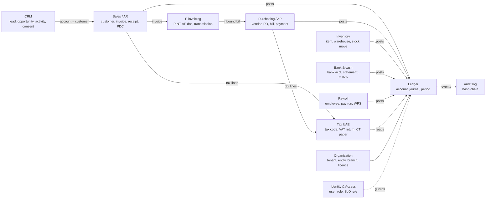
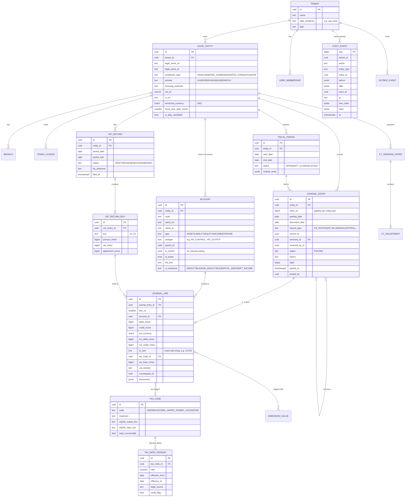
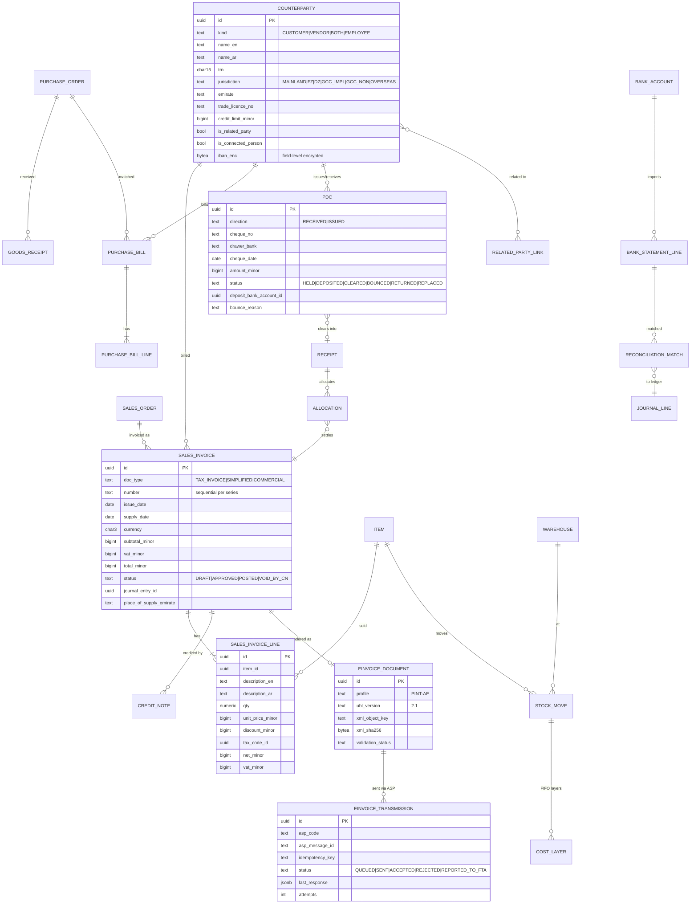
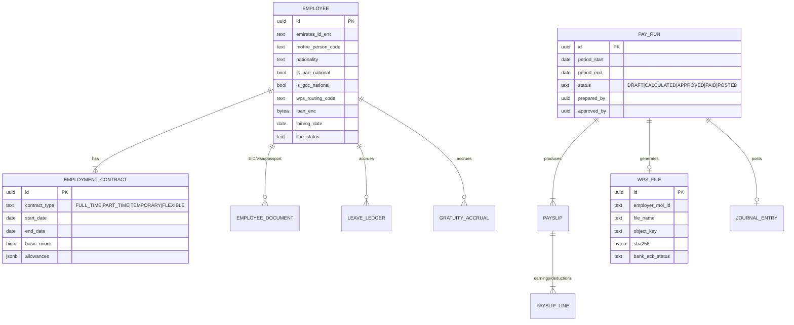
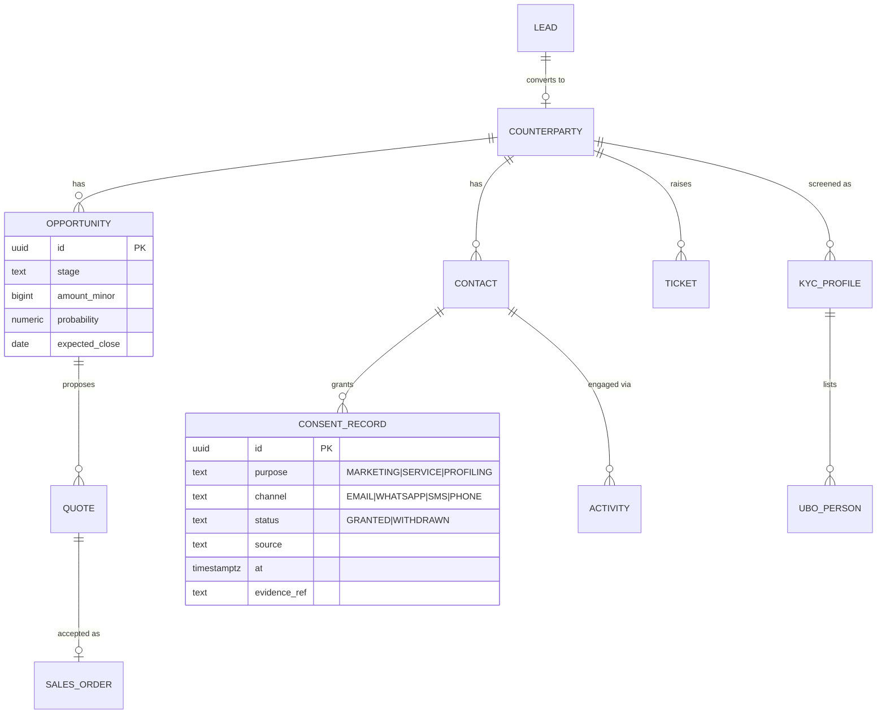

# 06 — Domain model / ERD

Conventions:
- Every table carries `tenant_id` and is protected by Postgres Row-Level Security.
- Money is `bigint` minor units plus a `currency` char(3).
- Ledger tables are append-only.
- Every row carries `created_at` and `created_by`. Business tables also carry `version` for optimistic locking.

## 6.1 Bounded contexts

Posting rule: **only the Ledger context writes `journal_entries`**. Other contexts publish a *posting request*, a domain command that carries a source-document reference. The ledger validates it (balanced, open period, active accounts) and posts it atomically in the same database transaction as the source document. The outbox then emits `JournalPosted`.

## 6.2 Core ERD — organisation, ledger, tax

## 6.3 Sales, purchasing, bank, e-invoicing

## 6.4 Payroll

## 6.5 CRM core (Phase 2)

## 6.6 Invariants (enforced in code **and** in the database)

| # | Invariant | Where it is enforced |
|---|---|---|
| I-1 | For each journal entry, Σ debit_minor = Σ credit_minor (functional currency) and > 0 | `@falaj/ledger` `validateEntry`; DB deferred constraint trigger |
| I-2 | When every line of an entry carries the same transaction currency, Σ txn debits = Σ txn credits in it. Mixed-currency entries (e.g. a USD receipt into an AED bank with an FX gain) balance in AED only. | `@falaj/ledger` |
| I-3 | Each line is debit XOR credit, both non-negative | Ledger + DB `CHECK` |
| I-4 | Posted entries/lines never UPDATE or DELETE | DB trigger raising an exception; app role has no UPDATE/DELETE grants on ledger tables |
| I-5 | Posting date must be in an OPEN period (or SOFT_CLOSED with a module permission) | Ledger `PeriodPolicy`; DB check function |
| I-6 | Reversal is a mirrored entry that links both ways; an entry can be reversed at most once | Ledger `reverse()`; unique index on `reverses_id` |
| I-7 | `entry_no` is gapless per entity and fiscal year | Sequence table with row lock in the posting transaction |
| I-8 | Audit-event hash = SHA-256(prev_hash ‖ canonical_json(event)) | `@falaj/ledger` `HashChain`; verified by an auditor export tool |
| I-9 | Control accounts accept postings only from their owning sub-ledger | Ledger `AccountPolicy` |
| I-10 | Every tax-coded line carries tax_code_id, tax_base and, for output VAT, emirate | Ledger + VAT engine validation |
