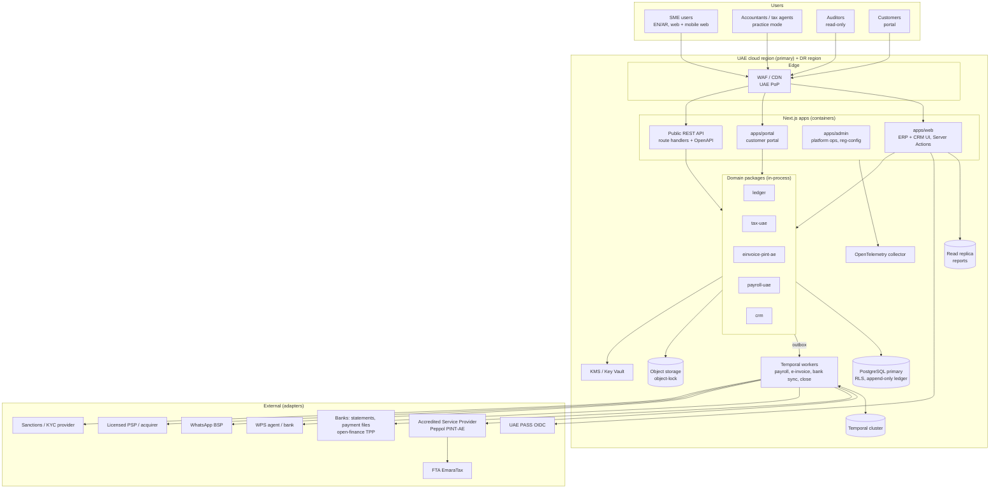

# 07 — System architecture & repository structure

## 7.1 Decisions (with justification)

| Concern | Decision | Why |
|---|---|---|
| Frontend / BFF | **Next.js 16 (App Router)**, React Server Components, Server Actions for mutations, TypeScript `strict` | RSC keeps heavy data grids and reports server-side, close to Postgres, which is good for large trial balances. Server Actions give typed mutations without a separate REST layer for first-party UI. A public REST/OpenAPI API is added for integrators (F-PLT-16). |
| UI | Tailwind CSS v4 + shadcn/ui, logical CSS properties, `dir` switching; **Falaj brand tokens** (Palm/Channel/Spring/Sarooj/Limestone/Basalt; Readex Pro display, IBM Plex Sans + Plex Sans Arabic body, Plex Mono for amounts/TRN/IBAN kept LTR inside RTL) | Logical properties (`ms-*`, `pe-*`) make RTL mostly free. shadcn gives owned source code, which we can audit and make RTL-safe. |
| i18n | `next-intl` with `[locale]` segment (`en`, `ar`) | First-class App Router support, ICU messages, RSC-compatible. |
| Monorepo | **pnpm workspaces + Turborepo** | Shared domain packages, cached builds and tests, clear dependency boundaries. |
| Style | **Modular monolith**: one deployable per app, bounded contexts as packages, no cross-context table access | This is the fastest path for a small team. Contexts can be extracted into services later along package boundaries. |
| Domain events | **Transactional outbox**: `outbox_events` written in the same transaction, relayed to the workflow engine or a queue | Guarantees "journal posted ⇒ event emitted" with no dual-write inconsistency. |
| Database | **PostgreSQL 17** (managed, UAE region); **RLS** keyed on `app.tenant_id` session setting; read replica for reporting | Mature, strong consistency, RLS gives defence in depth for multi-tenancy. |
| ORM | **Drizzle ORM** + SQL migrations | SQL-first, so RLS policies, triggers and deferred constraints live in reviewed SQL. Type-safe queries without an opaque runtime. |
| Money | `bigint` minor units in the DB; `bigint` in TypeScript (`Money` value object) | No floating point anywhere near money. |
| Ledger integrity | Append-only tables (trigger + grants), reversal-only corrections, per-tenant hash-chained audit log | Evidence for the FTA and auditors (ISA 500); tamper evidence. |
| Workflows | **Temporal** (self-hosted in the UAE region, or Temporal Cloud if a UAE region is available — VERIFY) | Durable, retryable, long-running flows: payroll runs, e-invoice submission and retry, bank sync, period close, scheduled VAT pack. |
| Auth | OIDC via **Auth.js / custom OIDC client**. IdPs: email+password (Argon2id) + TOTP/WebAuthn MFA, Microsoft Entra, Google, **UAE PASS**. Authorisation: RBAC + ABAC policy engine (Cedar or a simple in-house policy DSL) + SoD rules | UAE PASS is an OIDC provider. ABAC is needed for entity, branch and amount conditions. |
| Integrations | **Adapter (ports & adapters) interfaces** per capability: `EInvoiceAsp`, `BankFeed`, `BankPaymentFile`, `WpsAgent`, `PaymentGateway`, `WhatsAppBsp`, `Ocr`, `SanctionsScreening` | Swap vendors without touching the domain; contract-test each adapter. |
| Files | Object storage (UAE region), SSE-KMS, immutable (object lock) buckets for issued invoices, e-invoice XML and WPS files | Tamper-evidence and retention. |
| Security | TLS 1.2+, AES-256 at rest, field-level encryption (envelope, KMS) for Emirates ID/passport/IBAN, secrets in KMS/Key Vault, OWASP ASVS L2, CSP, SSRF guards on webhooks, yearly pentest plus one per major release | Brief and L-20 |
| Observability | OpenTelemetry traces/metrics/logs → collector → UAE-hosted backend; structured JSON logs with `tenant_id` and `trace_id`, with PII redaction; SLOs (API p95 < 400 ms; posting availability 99.9%); Sentry-compatible error tracking (self-hosted) | Residency-safe telemetry |
| Testing | Vitest unit tests (worked examples for every tax/payroll calc); **fast-check** property tests (ledger balance); Pact-style contract tests for adapters; Playwright E2E in both `en` and `ar` (RTL snapshots) | Brief |
| AI | Suggestions only; results stored as `suggestion` records, and a human must accept before any posting | Brief rule: never auto-post. |

## 7.2 System context & container diagram



## 7.3 Request and posting flow (sales invoice → e-invoice)

```mermaid
sequenceDiagram
  autonumber
  actor U as Accountant
  participant W as apps/web (Server Action)
  participant S as Sales context
  participant T as tax-uae
  participant L as ledger
  participant DB as Postgres (tx)
  participant O as Outbox relay
  participant WF as Temporal: EInvoiceWorkflow
  participant A as ASP adapter

  U->>W: Approve & post invoice
  W->>S: postInvoice(cmd, actor)
  S->>T: computeInvoiceTax(lines, context)
  T-->>S: tax lines + validator result
  S->>L: buildPosting(invoice, taxLines)
  L-->>S: JournalEntry (validated, balanced)
  S->>DB: BEGIN; insert invoice, journal, audit event, outbox(InvoicePosted); COMMIT
  O->>WF: start(InvoicePosted)
  WF->>WF: render PINT-AE XML, validate
  WF->>A: submit(xml, idempotencyKey)
  A-->>WF: accepted / rejected
  WF->>DB: update transmission status (+ audit event)
```

## 7.4 Multi-tenancy & RLS

- Each request resolves `tenant_id` from the session. It sets `SET LOCAL app.tenant_id = '<uuid>'` and `SET LOCAL app.user_id` in the transaction.
- Every table has the policy `USING (tenant_id = current_setting('app.tenant_id')::uuid)` with `FORCE ROW LEVEL SECURITY`.
- The application DB role is **not** the table owner and has no `BYPASSRLS`. Ledger tables grant INSERT and SELECT only.
- Platform-admin cross-tenant operations use a separate role in `apps/admin`, with break-glass logging.
- Optional per-tenant isolation tier: a dedicated database for large tenants, using the same schema.

## 7.5 Repository structure

```
NewCo/  (Falaj monorepo)
├─ apps/
│  ├─ web/                  # Next.js ERP + CRM (App Router, [locale]/(app)/…)
│  ├─ portal/               # Customer portal (Phase 2)
│  ├─ admin/                # Platform admin, regulatory config review (Phase 1 late)
│  └─ worker/               # Temporal workers (Phase 1)
├─ packages/
│  ├─ core/                 # Money, currency, UAE validators (TRN, EID, IBAN), amount-in-words, Result types, RegulatoryConfig
│  ├─ company/              # Licence import + the one company record (strategy v2)
│  ├─ workspace/            # Domain + email provisioning via registrar / reseller ports
│  ├─ website/              # Bilingual site generator
│  ├─ compliance/           # Compliance calendar
│  ├─ provisioning/         # Licence-to-live saga, CoA templates, plans
│  ├─ ledger/               # Double-entry domain: accounts, entries, validation, reversal, periods, hash chain, trial balance
│  ├─ tax-uae/              # VAT engine, VAT201, CT computation, effective-dated regulatory config
│  ├─ einvoice-pint-ae/     # PINT-AE UBL 2.1 generation/validation, ASP port
│  ├─ payroll-uae/          # Gratuity, leave, WPS SIF, GPSSA
│  ├─ db/                   # Drizzle schema, SQL migrations (RLS, triggers), repositories
│  ├─ ui/                   # shadcn-based, RTL-safe component library
│  └─ config/               # shared tsconfig / eslint presets
├─ docs/                    # Deliverables 00–09
├─ turbo.json
├─ pnpm-workspace.yaml
└─ package.json
```

Dependency rules: `ledger`, `tax-uae`, `payroll-uae` and `einvoice-pint-ae` depend only on `core`. The ledger and tax engines do not import each other; apps compose them, for example ledger lines → VAT201 in `apps/web/src/lib/demo.ts`. `db` implements the ledger's ports. Domain packages **never** import `db`, `next` or any adapter. The rule holds today by construction; `eslint-plugin-boundaries` should enforce it once linting is added.

**Scaffold status (this repo):**

| Package | Status |
|---|---|
| `@falaj/core` | Built. Money (bigint, half-up), UAE validators (TRN, Emirates ID, IBAN, phone), EN/AR amount-in-words, effective-dated `RegulatoryConfig`. |
| `@falaj/ledger` | Built. Validation (I-1…I-10), immutable entries, reversal-only corrections, periods and module locks, gapless numbering, trial balance with drill-down, hash-chained audit log. Includes property-based tests. |
| `@falaj/tax-uae` | Built. VAT codes and line/document calculation, VAT201 builder with per-box drill-down, tax-invoice validator, CT computation (SBR, QFZP de minimis, entertainment), e-invoicing mandate calendar, UAE default rules. |
| `@falaj/db` | Built. SQL migration (RLS, append-only triggers, deferred balance check, period check, grants), Drizzle schema, Postgres ledger repository, audit sink and tenant transactions. Tested against real Postgres via PGlite. |
| `@falaj/payroll-uae` | Partial. Gratuity, leave entitlement and WPS SIF builder are done. GPSSA, ILOE and the full pay run come in E-09. |
| `@falaj/einvoice-pint-ae` | Ports only (ASP and renderer interfaces). The renderer will be built in E-07 against the official PINT-AE artefacts. |
| `apps/web` | Shell only. Next.js 16 + next-intl (EN/AR, RTL) + Tailwind v4 with Falaj brand tokens. The demo dashboard posts sample data through the real ledger and VAT engine. |
| `@falaj/company` | Built (strategy v2). Licence model, authorities, validation, one company record, UBO candidates, `LicenceSource` port. |
| `@falaj/workspace` | Built (strategy v2). Domain suggestions, mailbox plan, email/website DNS records, registrar and email-reseller ports. |
| `@falaj/website` | Built (strategy v2). Bilingual static-site generator with escaping, and a hosting port. |
| `@falaj/compliance` | Built (strategy v2). Compliance calendar from the company record and effective-dated rules. |
| `@falaj/provisioning` | Built (strategy v2). Seven-step licence-to-live saga (idempotent, resumable, audited), vertical charts of accounts, plans, open-finance and ASP ports. |
| `apps/web` routes | `/` Company OS home, `/launch` live saga run on sample licences, `/ledger` Run preview. |
| `ui`, `portal`, `admin`, `worker` | Not created yet. Next up: partner portal, accounting-firm console, and a Temporal worker hosting `runLaunch`. |