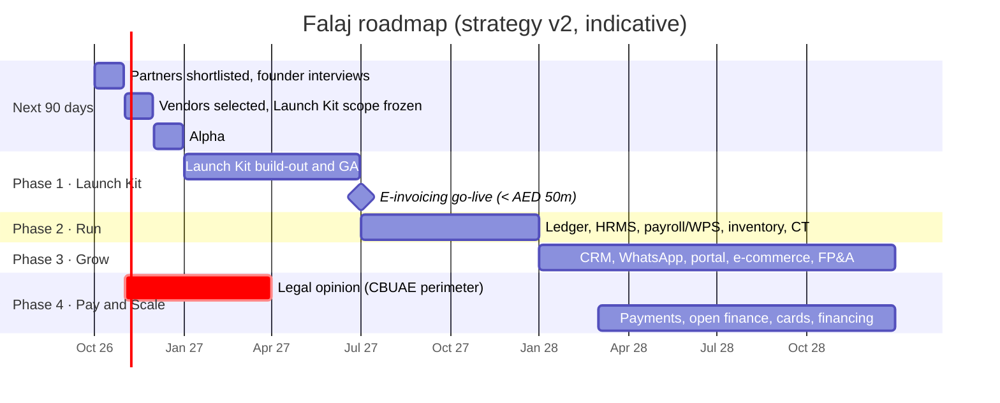

# 08 — Phased roadmap (aligned to strategy v2)

Plan date: **1 Oct 2026**. Source: Falaj Company OS Strategy v2 (see [`10-strategy-alignment.md`](10-strategy-alignment.md)).

**Rule from the strategy:** no phase starts until the previous phase meets its exit criterion. All targets are proposed, not forecasts. Regulatory dates are configuration (VERIFY with MoF/FTA).

| Phase | When | Scope | Exit criterion (strategy) | Engineering status (1 Oct 2026) |
|---|---|---|---|---|
| **0 · Alpha** | Oct–Dec 2026 | Licence-to-live flow with real partners for 20 companies | 20 companies live on the flow; pricing study done; pre-seed closed | Flow built end to end against sandbox partners. Real adapters wait on the November vendor selection |
| **1 · Launch Kit** | Q1–Q2 2027 | Licence import, domain, email, website, bank feeds, invoicing, VAT, e-invoicing via ASP, contacts, compliance calendar | **1,000 companies set up; 100 paying on e-invoicing by 1 Jul 2027** | Company record, workspace, website, compliance calendar, provisioning saga, VAT/e-invoicing engines and DB built. Still to build: invoice UI, contacts, partner portal, billing, PINT-AE renderer |
| **2 · Run** | H2 2027 | Full ERP ledger, HRMS, payroll, WPS and GPSSA, expenses, inventory, Corporate Tax engine | **First CT returns filed on Falaj** | Ledger, CT computation, gratuity, leave and WPS SIF already built (docs 06–09). Launch → ledger hand-off tested |
| **3 · Grow** | 2028 | CRM, WhatsApp, client portal, campaigns, e-commerce, projects, FP&A | **Paying companies use three or more modules** | Not started |
| **4 · Pay and Scale** | 2028 onward | Payments, open finance, cards and financing via partners; multi-entity and consolidation | **Fintech revenue ≥ 15% of total** | Partner-only design and licensing map (doc 05). Gated on a legal opinion |

## Board scorecard (strategy "what must be true")

| # | Target | Instrumented by |
|---|---|---|
| 1 | < 1 day from licence issue to operating on Falaj | `licenceToLive()` per launch run |
| 2 | 1,000 companies set up by Dec 2027 | `companies` table |
| 3 | 100 companies paying for e-invoicing before 1 Jul 2027 | Billing (to build after pricing study) |
| 4 | 3+ modules used by the average paying company | Plan entitlements + usage events (to build) |
| 5 | ≥ 90% gross revenue retention | Billing (to build) |
| 6 | 30 setup-agent partners by Dec 2027 | `partners` table |

## Risks carried from the strategy

| Risk | Engineering defence already in place |
|---|---|
| Building every module at once | Phase gates; the Launch Kit reuses the built ledger/VAT engines; commodity layers are ports, not builds |
| Dependency on email, registrar or ASP vendors | Every vendor sits behind a port with a fake; contract tests to be added per vendor; two suppliers per layer |
| Payment features fall inside CBUAE scope | No money movement in code; bank link is consent-only via a licensed provider |
| One breach exposes every layer | RLS on every tenant table, append-only ledger, hash-chained audit, output escaping on generated sites, field-level encryption column for Emirates IDs |
