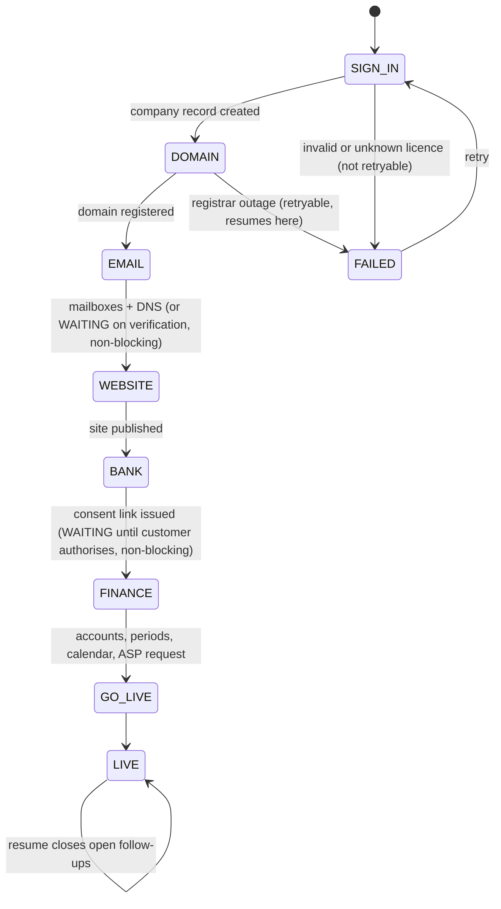

# 10 — Strategy alignment: Falaj Company OS (v2)

> Source: **Falaj Company OS Strategy** deck, version 2, 30 Sep 2026 ([artifact](https://claude.ai/artifact/1fSp6KpaJBewsi2ySs7DSF)). Where it disagrees with docs 00–09, which were written from the original ERP-first build prompt, **the strategy wins**. Not legal or tax advice.

## 10.1 What changed

| Topic | Original brief (docs 01–09) | Strategy v2 (now binding) |
|---|---|---|
| Positioning | UAE SME ERP → CRM → enterprise finance → fintech | **Company operating system**: "Licence in the morning. Open for business by the afternoon." |
| Beachhead | Existing SMEs re-platforming for CT and e-invoicing | **Companies at licence issue** (250k formed in 2025), then young SMEs on patchwork tools; established SMEs (AED 3–50m) are wave 2; mid-market is wave 3 |
| Phase 1 | Full ERP core: GL, AR/AP, inventory, payroll, VAT/CT, e-invoicing | **Launch Kit (Q1–Q2 2027)**: licence import, domain, email, website, bank feeds, invoicing, VAT, e-invoicing via ASP, contacts, compliance calendar |
| Phase 2 | CRM | **Run (H2 2027)**: full ERP ledger, HRMS, payroll/WPS/GPSSA, expenses, inventory, Corporate Tax engine |
| Phase 3 | Enterprise finance | **Grow (2028)**: CRM, WhatsApp, client portal, campaigns, e-commerce, projects, FP&A |
| Phase 4 | Fintech | **Pay and Scale (2028 onward)**: payments, open finance, cards, financing via partners; multi-entity, consolidation |
| Phase gating | Dates | **No phase starts until the previous one meets its exit criterion** |
| Verticals | Trading, contracting, professional services | **Professional services, trading, e-commerce, contracting** (in that order) |
| Channel | Accountants / tax agents | **Licensing channel is primary**: setup agents and PROs (recurring revenue share), free zones, bank SME desks, accounting firms (multi-client console) |
| Build vs partner | Everything as ERP modules | Build the data model, compliance layer, website builder, ERP, HR/payroll and CRM. **White-label** email (M365/Google reseller) and domains (registrar). **Licensed partners** for the ASP, PSP and open finance |
| Pricing | Not specified | Launch (1–5 people) / Grow (6–50) / Scale (51–250, quoted) / Pay (usage). **Prices are `[AED __]` until the willingness-to-pay study** |

**Naming reconciliation.** The Brand Book's product architecture (falaj Ledger / Clients / Enterprise / Pay) predates strategy v2. The build uses the strategy's phase names (Launch Kit / Run / Grow / Pay and Scale) under the single **falaj** master brand. The "Ledger" name survives as the ledger screen inside Run. **Decision for the founders:** update the Brand Book's §05 to match.

## 10.2 Strategy → build decisions → code

| Strategy element | Build decision | Where it lives |
|---|---|---|
| Journey step 1 · Sign in: "UAE PASS login; trade licence imported, owners and activities created once" | Canonical **company record** built from the licence and validated (authority, expiry, shares = 100%, Emirates ID, Arabic name). Vertical inferred. UBO candidates seeded at ≥25%. `LicenceSource` port for authority/UAE PASS integrations | `packages/company` |
| "One company, employee and customer record across email, ERP, HR, CRM and channels" | `Company` + `Person` is the single record every other package takes as input | `packages/company` → used by workspace, website, compliance, provisioning, db |
| Step 2 · Pick a domain | Suggestions from the trade name (legal suffixes stripped, `.ae` first). Registrar is a **partner** behind the `DomainRegistrar` port | `packages/workspace/src/domains.ts`, `ports.ts` |
| Step 3 · Create email | **White-label** reseller behind `EmailProvider`. Falaj plans mailboxes (one per licence party, plus `info@` and `accounts@`) and writes MX/SPF/DMARC/verification DNS | `packages/workspace/src/email.ts` |
| Step 4 · Launch website | **Build**: bilingual (EN/AR, RTL) static site generated from the licence, with licence disclosure, WhatsApp, Makani and a PDPL notice template. All fields escaped | `packages/website` |
| Step 5 · Link your bank | Licensed open-finance partner behind `OpenFinanceProvider`. The customer authorises in their bank; the step is **non-blocking** | `packages/provisioning/src/ports.ts` |
| Step 6 · ERP and HR ready | Vertical chart of accounts (VAT control accounts, CT tags), fiscal periods for a 6–18 month first year, ASP onboarding request, compliance calendar | `packages/provisioning/src/coa.ts`, `launch.ts` |
| Step 7 · Go live | Launch state goes `LIVE`, with open follow-ups listed (email verification, bank consent) | `packages/provisioning/src/launch.ts` |
| "Licence to operating in under one working day" (scorecard #1) | `licenceToLive()` measures run start → live against an 8-hour target and lists open items | `packages/provisioning` |
| "Compliance is a layer under every module" | Compliance calendar from the company record plus effective-dated rules: licence renewal, CT registration and return, VAT registration/returns, e-invoicing ASP and go-live, UBO, WPS | `packages/compliance` |
| Launch Kit scope: invoicing, VAT, e-invoicing | Already built: ledger, VAT engine, VAT201, tax-invoice validator, e-invoicing mandate calendar | `packages/ledger`, `packages/tax-uae` |
| Tiers and prices | `PLANS` with module entitlements; `recommendPlan(headcount)`. Prices are `null`, never invented | `packages/provisioning/src/plans.ts` |
| Setup agents earn a recurring share | `PartnerAttribution` on the company. `partners.revenue_share_pct` stays NULL until an agreement sets it | `packages/company`, `db/migrations/0002` |
| "Two suppliers per critical layer, behind adapters" (risk slide) | Every partner is a port with a fake. Real adapters are added per vendor | `*/ports.ts`, `*/fakes.ts` |
| Hand-off from Launch Kit into Run | `materialiseLaunch()` turns a live launch into a legal entity, periods and chart of accounts. The ledger posts to it straight away (tested) | `packages/db/src/launch-store.ts` |

## 10.3 Launch run, as built

Properties the tests hold:

- Each partner call carries a run-scoped idempotency key.
- DONE steps are never re-run.
- State is plain JSON, persisted after every step in `launch_runs`.
- Every step writes to the hash-chained audit log.

## 10.4 Scorecard instrumentation

| Strategy target | How the product measures it | Status |
|---|---|---|
| < 1 day licence to operating | `licenceToLive(state)` per run; aggregate from `launch_runs.started_at/live_at` | Built (per run) |
| 1,000 companies set up by Dec 2027 | `count(*) from companies` | Schema built |
| 100 paying for e-invoicing before 1 Jul 2027 | Needs billing and subscription tables | **To build** (with billing, after pricing study) |
| 3+ modules per paying company | Module entitlements exist on plans; usage events needed | **To build** |
| ≥ 90% gross revenue retention | Billing | **To build** |
| 30 setup-agent partners by Dec 2027 | `count(*) from partners where type = 'SETUP_AGENT'` | Schema built |

## 10.5 What is deliberately not built yet

- **Real partner adapters** (registrar, M365/Google reseller, ASP, open-finance provider, hosting). These depend on the November 2026 partner selection in the 90-day plan. Ports and fakes are ready.
- **UAE PASS and authority licence APIs.** They depend on partnerships (free zones, licensing authorities). The `FixtureLicenceSource` serves the December alpha.
- **Billing and pricing.** Blocked on the willingness-to-pay study; no prices are invented.
- **Accounting-firm multi-client console** (GTM channel 4) and a **partner portal** for setup agents. Next UI work.
- **Durable workflow host.** `runLaunch` is written to be a Temporal activity body; the worker app is not created yet.
- **PINT-AE renderer.** Still waits on the official artefacts (see `packages/einvoice-pint-ae`).

## 10.6 Next engineering steps, mapped to the 90-day plan

| Month | Strategy action | Engineering action |
|---|---|---|
| Oct 2026 | Interview 30 founders; shortlist email, registrar and ASP partners | Instrument the launch flow for alpha feedback. Write adapter contract tests the shortlisted vendors must pass |
| Nov 2026 | Sign 2 setup agents and 5 accounting firms; select vendors; freeze Launch Kit scope | Real adapters for the chosen registrar, email reseller and ASP. Partner portal v0 (activation link + attribution). Temporal worker |
| Dec 2026 | Alpha: licence-to-live with 20 companies; pricing study | Run the 20 alpha launches through `launch_runs`. Report licence-to-live per run. Add billing once prices are set |
